# Computer Vision for Customer & Demand Analytics

**Repository name:** `computer-vision-demand-analytics`

A computer vision–based analytics system for understanding customer behavior, monitoring foot traffic, and extracting demand insights from visual data.

The current implementation uses pretrained YOLO11s and ByteTrack to detect people and vehicles in recorded video, assign temporary tracking IDs, and count directional entrance-line crossings. Apple Metal is supported on the local Mac. Engagement scoring and demand forecasting are not implemented.

## Intended use and next steps

This project serves as a baseline for monitoring my privately owned business once the on-site camera is installed. The current public-dataset tests establish a starting point. After installation, I plan to calibrate the camera view and entrance boundaries, collect representative footage, and further tune detection and tracking for the actual layout, lighting, customer movement and occlusions. Better results are expected from this camera-specific tuning, but improvements must be measured against manually labeled business footage before operational use.

**Upcoming: NVIDIA Metropolis Camera Calibration Toolkit.** Evaluate its camera-to-floor-plan mapping, regions of interest and virtual tripwires after installation. Reference: NVIDIA’s [Simplifying Camera Calibration to Enhance AI-Powered Multi-Camera Tracking](https://developer.nvidia.com/blog/simplifying-camera-calibration-to-enhance-ai-powered-multi-camera-tracking/) and the [toolkit user guide](https://docs.nvidia.com/mms/text/MDX_Camera_Calibration_User_Guide.html). Calibration maps image coordinates to physical space; detector/tracker tuning remains a separate task. Integration is planned and has not yet been implemented or validated.

## CPU-to-GPU processing improvement

The retail workflow progressed from CPU-based detection to **GPU-accelerated inference on the Apple M1 Pro through Metal / PyTorch MPS**. The selected GPU replay processes all 12 retail clips (16,605 frames) at **30.2 FPS end to end**, including process/model startup, decoding, tracking, overlays and video writing. GPU inference is enabled with `--device mps`; decoding, tracking and encoding still involve CPU work.

| Processing stage | CPU baseline | Selected GPU workflow |
| --- | --- | --- |
| Detector execution | CPU | **Apple M1 Pro GPU (Metal/MPS)** |
| Full retail replay throughput | Reliable historical timing unavailable | **30.2 FPS measured** |

A numerical CPU-to-GPU speedup cannot be established from the saved evidence: the earlier CPU replay used cached, batched person-only detections, while the GPU run uses frame-by-frame people/vehicle inference. On the six retail clips with saved CPU crossing results, the initial GPU replay reproduced those crossing scores. Subsequent counting improvements are reported separately below; moving computation to the GPU alone is not claimed to improve accuracy. The sustained 1080p load test reaches approximately 24 FPS and accumulates backlog at a 30 FPS arrival rate.

[CPU/GPU comparison provenance](docs/metrics/cpu-to-gpu.json) · [timing details](docs/performance.md)

## Metrics on labeled datasets

**Bold values indicate the better measured outcome for each metric; ties are left unbolded.**

**Measured on saved evaluation runs, not a new independent benchmark.** The CAVIAR clips below were inspected and used for camera-specific tuning. Results apply to this selected footage and configuration, not to the New York, Korea, or Taiwan gallery clips.

### CAVIAR retail entrance: 12 clips · 16,605 frames · 37 reference crossings

Pretrained YOLO11s/640 + ByteTrack, one detector pass, Apple Metal. Crossing references use published human track IDs and reviewed entrance events.

| Metric | Earlier configuration | Selected configuration |
| --- | ---: | ---: |
| Crossing precision, within 1 second | 51.6% | **94.3%** |
| Crossing recall, within 1 second | 43.2% | **89.2%** |
| Crossing F1, within 1 second | 47.1% | **91.7%** |
| Matched / extra / missed events, within 1 second | 16 / 15 / 21 | **33 / 2 / 4** |
| Identity-supported crossing F1, within 3 seconds | 88.2% | **97.2%** |
| Identity-supported matches / extra / missed, within 3 seconds | 30 / 1 / 7 | **35 / 0 / 2** |
| Entry / exit totals (reference: 19 / 18) | 20 / 11 | **19 / 16** |
| Sum of absolute per-clip directional count errors | 8 | **2** |
| Full-scene tracking HOTA / IDF1 (0–100) | 41.84 / 58.44 | 41.84 / 58.44 |
| Full-scene ID switches | 65 | 65 |
| End-to-end processing throughput | **30.9 FPS** | 30.2 FPS |

The one-second metric matches events one-to-one by direction and timing. The three-second metric additionally requires box associations to the labeled human track ID; its wider timing tolerance explains the higher score. It is not personal identity recognition. Tracking scores are separate from counting scores: the selected counter improves crossing results without improving HOTA or IDF1. Labels may omit real background people. Throughput includes process/model startup, decoding, tracking, overlays and output writing for one sequential run; it is not a guaranteed live-camera rate.

### Later MOT17 / UA-DETRAC tracked-box study: adjustment rejected

On **440 later-window native-FPS frames / 4,179 publisher-labeled appearances**, retain the initial class-specific profile:

| Tracked-box metric | Adopted initial profile | Rejected tracker adjustment |
| --- | ---: | ---: |
| Recall | 75.21% | **75.28%** |
| F1 | **79.97%** | 79.71% |
| Precision | **85.38%** | 84.68% |
| Matched / unmatched / missed boxes | 3,143 / **538** / 1,036 | **3,146** / 569 / **1,033** |

#### Precision–recall curve

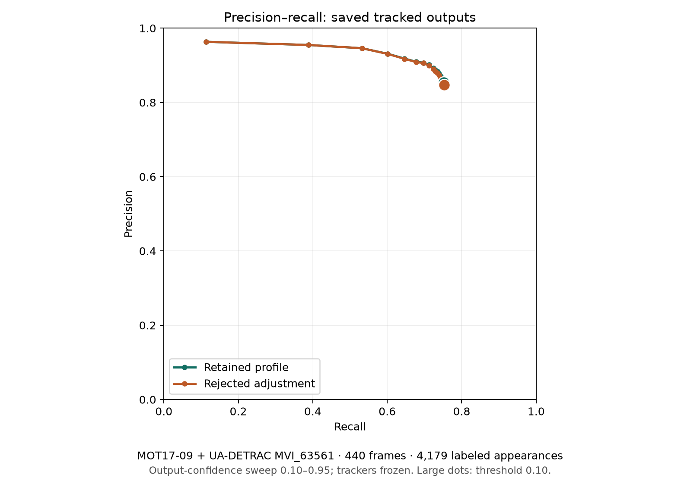

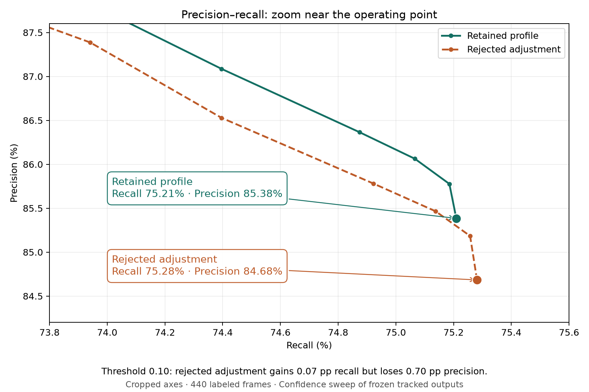

Zoomed axes highlight the small tradeoff at confidence 0.10: the rejected adjustment gains **0.07 percentage points of recall** but loses **0.70 percentage points of precision**.

This curve sweeps the confidence cutoff on **saved tracked boxes** from 0.10 to 0.95 and rescores the same 440 frames using the existing TrackEval matching and ignore rules. Trackers stay frozen; this is not a detector AP curve or a new threshold recommendation. Large dots mark the published 0.10 operating point. Results use known historical cameras rather than independent validation. [Raw points and method](docs/metrics/precision-recall/points.json) · [CSV](docs/metrics/precision-recall/points.csv) · [SVG](docs/metrics/precision-recall/curve.svg).

Only three extra matches cost 31 extra unmatched predictions. The user retained person track initiation 0.55 and 30-frame retention, rejecting initiation 0.50 with 2.4-second retention. Class cutoffs remain car 0.50, truck 0.40, bus 0.55 and person/motorcycle 0.10. General application defaults were never promoted to the rejected experiment, and no detector weights changed. These box metrics are separate from CAVIAR crossing scores; earlier source windows/cameras were already used in development.

[Review the rollback rationale, actual output comparisons, and unchanged source reports](docs/metrics/confidence-study/README.md).

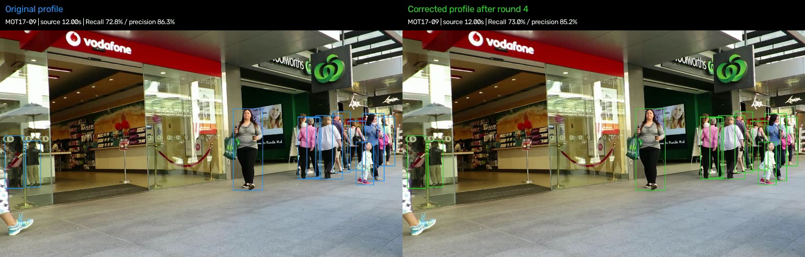

### Dataset coverage

| Labeled dataset | Use in this project | Available result and limits |
| --- | --- | --- |
| [CAVIAR](https://homepages.inf.ed.ac.uk/rbf/CAVIARDATA1/) | Published person boxes/track IDs and reviewed directional crossings; selected 12-clip retail replay | Metrics above. Previously inspected development, validation and holdout-named clips are pooled; this is known-data regression evidence. |
| [MOT17](https://motchallenge.net/data/MOT17/) | Labeled pedestrian footage; MOT17-02/04/09 in the new box study, plus MOT17-04 sustained playback | Native 1920×1080, 30 FPS input; 35 seconds repeated to schedule 9,000 frames over five minutes. **24.0 FPS** active processing and **75.36 s** final backlog. All 9,000 frames retained; YOLO resizes to 640. This run measures local processing load, not detection/tracking accuracy or network latency. |
| [UA-DETRAC](https://sites.google.com/view/daweidu/projects/ua-detrac) | Labeled vehicle footage retained locally for earlier experiments | New class-confidence study includes MVI_20011/40152/63561; later-window aggregate box scores above pool person and vehicle data. Categories are grouped, not scored as car-versus-truck classification. |

[Saved metric values and provenance](docs/metrics/labeled-evaluation.json) are included in the repository. Dataset videos, labels and generated output videos remain local. No detector training was performed for the selected Metal run; pretrained training-data overlap has not been audited. The location-gallery clips have no complete manual labels and are not included in these scores.

## Before and after

Original footage and processed output at the same frame. “Before” means source footage; “after” means tracking overlays, not a comparison of model accuracy.

### Location test replays

Examples from our saved New York, South Korea, and Taiwan test clips. Each pair shows frame 40 (8.00 seconds) of the same recording, at its original 1280×720 resolution.

| Location | Before: original footage | After: tracking output |
| --- | --- | --- |
| Times Square, New York, USA | 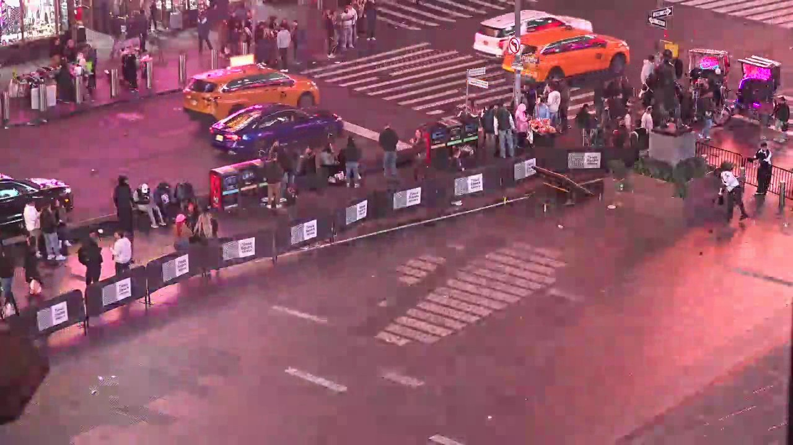 | 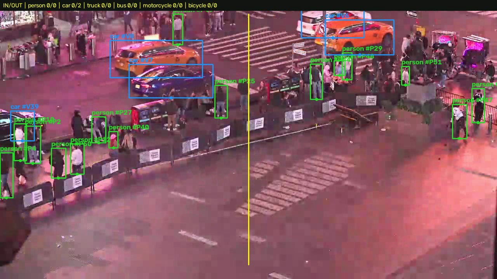 |
| Songridan-gil, Seoul, South Korea | 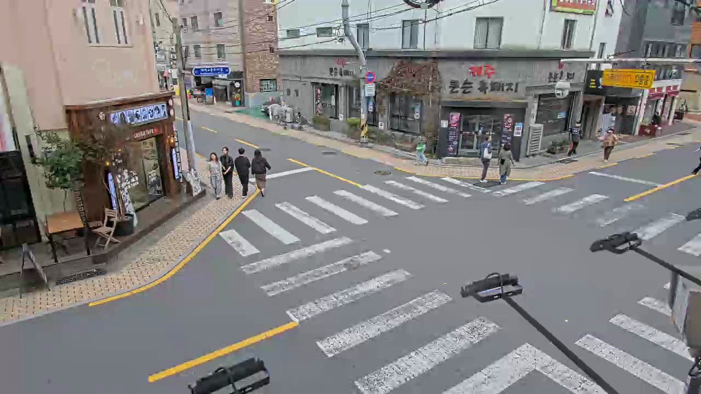 | 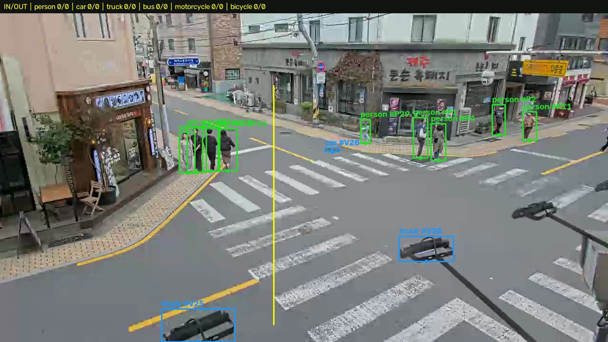 |
| Linkou Old Street, New Taipei City, Taiwan | 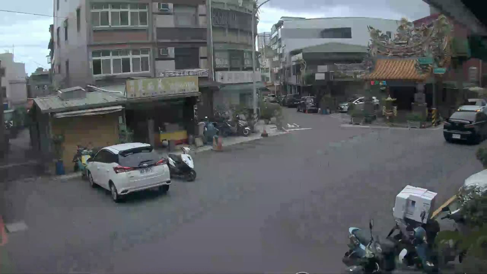 | 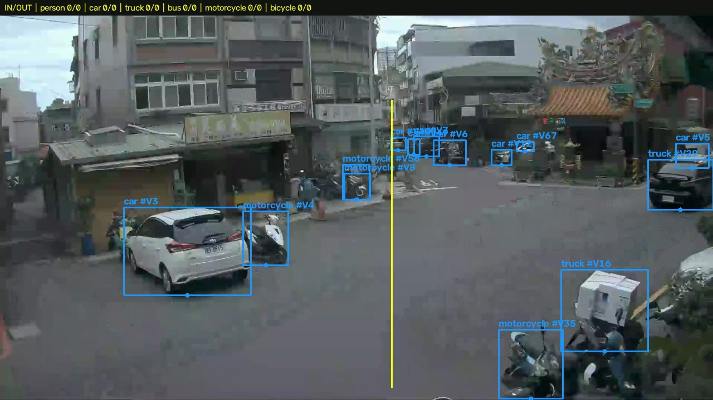 |

These are fresh short replays of previously collected test clips, using pretrained YOLO11s/1280 and ByteTrack on CPU. They are not recovered images of the deleted historical runs or an independent accuracy benchmark. Lines represent illustrative image-boundary crossings, not verified store entrances. See [source attribution and replay settings](docs/screenshots/README.md#location-test-replays).

### New York observation: idle person at the beginning

A person standing idle near the beginning of the New York footage was reported as not counted. This system counts confirmed line crossings, so an idle person does not increase the counter until they cross the configured boundary. Counts do not measure everyone visible, occupancy, or unique visitors. If the person has no detection box or temporary track ID, that is a separate detection/tracking miss that requires frame-level review.

The replay uses detector confidence **10%** and a **55%** new-track threshold. The latter can prevent a weaker detection from starting a track, but the cause of the reported missing track remains unconfirmed. A displayed box confidence is a prediction score, not the configured cutoff.

### Known limitation: mannequin detected as a person

The original retail walkthrough illustrates a false positive: a shop mannequin is classified and tracked as a person. A stable tracking ID does not establish that a detection is a real customer. Such detections can distort customer-activity measures and could affect crossing counts if their tracked position crosses the configured line; this image alone does not establish a false crossing event.

| Before: original retail footage | After: mannequin false positive in tracking output |
| --- | --- |
| 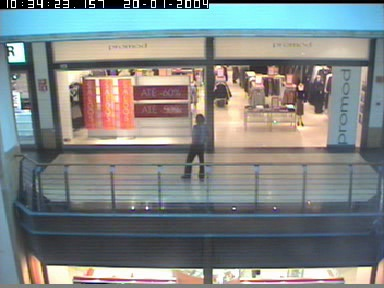 | 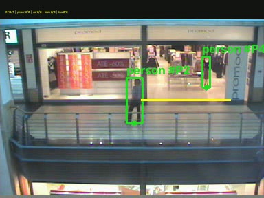 |

This existing CAVIAR replay frame is retained as a failure example, not evidence of successful customer identification. It is frame 700 (28.00 seconds) of `OneShopOneWait2front`, using YOLO11s/640 on Apple Metal. Scene-specific exclusion zones and representative person/mannequin labels are possible mitigations; they have not been validated here.

## Install

Requires Python 3.10 or newer. From the repository folder:

```sh
python3 -m venv .venv
.venv/bin/python -m pip install -e .
computer-vision-demand-analytics --help
```

The installed command is available when `.venv/bin` is on your PATH (for example, after `source .venv/bin/activate`); otherwise use `.venv/bin/computer-vision-demand-analytics` or `.venv/bin/python tracker.py`.

Downloaded datasets, model weights, and generated outputs are excluded from this repository. Supply your own authorized constant-frame-rate recording and calibrate the entrance line for that camera. The `data/` examples and `outputs/` review links below refer to local evaluation artifacts and are not included in a fresh clone. The README screenshots are included under `docs/screenshots/`.

## Run a recording

From the project folder, using the existing virtual environment:

```sh
.venv/bin/python tracker.py data/retail-entrance/holdout/TwoEnterShop2front.mpg \
  --device mps --output outputs/metal-runs --name two-enter-shop2
```

The selected default camera profile is `configs/retail-metal.json`, with YOLO11s/640, detector confidence 0.1, IoU 0.7, and the existing low-FPS ByteTrack file. The source retail videos retain all frames at 25 FPS. No detector training or additional inference pass is enabled.

Compared with `configs/retail-baseline.json`, the selected standard-view profile extends the doorway boundary from x=300 to x=335 in the 384×288 camera image, narrows the deadband from 8 to 3 pixels, allows 0.8 seconds of counting continuity, and requires confidence 0.3 for person crossing measurements. The original person track-start threshold 0.55 and duplicate-box filtering remain. Weak detections still support ByteTrack and remain in observation exports; the extra crossing-confidence condition does not remove them from tracking.

A lower track-start threshold was rejected because it improved one more crossing but produced more unmatched boxes and worse tracking scores. The selected profile prioritizes crossing improvement without that regression. Settings are camera-specific and were tuned on known recordings, not evaluated on a fresh independent holdout.

For a different camera, supply its calibrated JSON with `--config`. The old zoomed CAVIAR view has a separate profile, `configs/retail-baseline-zoomed.json`; the new wide-view adjustments have not been validated for that view. `--preview path.jpg` draws the line on the first frame without inference.

## Repeat the complete Metal accuracy run

```sh
.venv/bin/python experiments/metal_replay.py --mode full --devices mps
```

This runs all 12 videos in `data/retail-entrance/manifest.json` without truncation or temporal sampling. Each invocation creates a new folder. Every video has its own annotated MP4, shared-format report, per-frame observations, log, and scored results. The batch records actual subprocess wall time, verifies output frame counts, preserves source hashes, and computes both the existing three-second identity-supported crossing metric and one-second event timing scores. Human-label tracking scores are separate diagnostics.

Source clips and labels have already been inspected and used for development. Improvement on these clips is regression evidence, not new-site accuracy. Full-scene labels may omit real background people; unmatched boxes can include real unlabeled people and false detections.

## Sustained playback test

```sh
.venv/bin/python experiments/sustained_metal.py --seconds 300
```

The saved MOT17-04 load test processed all 9,000 scheduled frames at approximately 24 FPS, accumulating 75.36 seconds of backlog. It repeats a 35-second native-1080p sequence, with detector input resized to 640. This is local processing throughput, not camera/network latency or counting accuracy. See [timing definitions and detailed reproduction guidance](docs/performance.md).

## Outputs

Each run writes an annotated MP4 and updates the output folder’s shared `report.json`. Repeated names receive a suffix. Use `--save-observations` for per-frame tracking CSV and `--save-timing` for timing CSV. Reports are written atomically; use one writer per output folder.

Source footage, labels, weights and generated videos remain local. Historical CPU output folders were removed during cleanup; their multi-stage experiment scripts may require rebuilding earlier reports. The saved Metal review is available locally at `outputs/metal-accuracy/review.html`. Published evidence is linked in the metrics section above.

## Source data and checks

The labeled sources and evaluation scope are listed in [Dataset coverage](#dataset-coverage). Run the code checks with:

```sh
.venv/bin/python -m unittest discover -s tests -q
```

This prototype handles local recorded files and arrival-paced replay. Direct RTSP/live-camera ingestion is not implemented. Temporary IDs may change during occlusion; no face recognition, persistent personal identity, cross-camera deduplication, or hourly occupancy claim is supported.

## Optional class-specific camera profiles

The adopted Seoul and Taiwan profiles retain car/truck/bus detector cutoffs of 0.50/0.40/0.55, person/motorcycle cutoffs of 0.10, person track initiation 0.55, and 30-frame retention. They are optional camera profiles; the default retail configuration is unchanged.

```sh
.venv/bin/python tracker.py data/retail-security-test/songridan-gil.mp4 \
  --config configs/class-confidence-seoul-songridan-gil.json \
  --model yolo11s.pt --imgsz 1280 --conf 0.1 --device cpu \
  --classes person car truck bus motorcycle bicycle \
  --output outputs/runs --name seoul-class-cutoffs
```

Use `configs/class-confidence-taiwan-linkou.json` for the Taiwan view. Keep base detector confidence at or below the smallest class cutoff. Recalibrate the line for a new camera.

The [confidence-study review](docs/metrics/confidence-study/README.md) contains the rollback rationale, four model-output comparisons and original reports. [Detailed development notes](docs/metrics/confidence-study/development-notes.md) retain the small foreground scoring table, candidate-search history and reproduction helpers.
