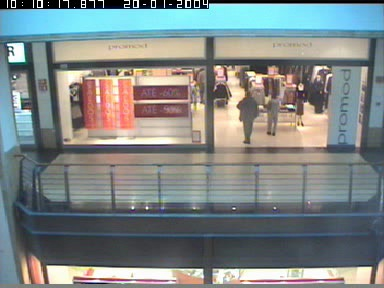
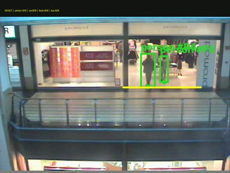

# Computer Vision for Customer & Demand Analytics

**Repository name:** `computer-vision-demand-analytics`

A computer vision–based analytics system for understanding customer behavior, monitoring foot traffic, and extracting demand insights from visual data.

The current implementation provides recorded-video detection, temporary tracking IDs, and directional crossing counts as inputs for customer and demand analysis. Engagement scoring and demand forecasting are not implemented.

## Before and after

Original footage and processed output at the same frame. “Before” means source footage; “after” means tracking overlays, not a comparison of model accuracy.

| Example | Before: original footage | After: tracking output |
| --- | --- | --- |
| Retail entrance · 18.00 s |  |  |
| Retail crossings · 28.00 s |  |  |

Screenshots use the existing YOLO11s/640 Metal replay of CAVIAR clips `TwoEnterShop3front` (frame 450) and `OneShopOneWait2front` (frame 700), both at 25 FPS. See [screenshot provenance](docs/screenshots/README.md) for source files. These examples illustrate output behavior and do not establish accuracy.

## Current implementation

A single-camera recorded-video prototype using pretrained YOLO11s, ByteTrack, temporary track IDs, and a finite entrance line. The active workflow uses Apple Metal on the local Mac. It detects people, cars, trucks, and buses; crossing counts are not unique visitors or occupancy.

Open [the Metal review](outputs/metal-accuracy/review.html) for the selected accuracy replay, the original eight crossing errors, all 12 output videos, and the sustained native-1080p playback test. Only Metal outputs appear in the active results folder.

## Install

Requires Python 3.10 or newer. From the repository folder:

```sh
python3 -m venv .venv
.venv/bin/python -m pip install -e .
computer-vision-demand-analytics --help
```

The installed command is available when `.venv/bin` is on your PATH (for example, after `source .venv/bin/activate`); otherwise use `.venv/bin/computer-vision-demand-analytics` or `.venv/bin/python tracker.py`.

Downloaded datasets, model weights, and generated outputs are excluded from this repository. Supply your own authorized constant-frame-rate recording and calibrate the entrance line for that camera. The `data/` examples and `outputs/` review links below refer to local evaluation artifacts and are not included in a fresh clone. The four README screenshots are included under `docs/screenshots/`.

## Run a recording

From the project folder, using the existing virtual environment:

```sh
.venv/bin/python tracker.py data/retail-entrance/holdout/TwoEnterShop2front.mpg \
  --device mps --output outputs/metal-runs --name two-enter-shop2
```

The selected default camera profile is `configs/retail-metal.json`, with YOLO11s/640, detector confidence 0.1, IoU 0.7, and the existing low-FPS ByteTrack file. The source retail videos retain all frames at 25 FPS. No detector training or additional inference pass is enabled.

Compared with `configs/retail-baseline.json`, the selected standard-view profile extends the doorway boundary from x=300 to x=335 in the 384×288 camera image, narrows the deadband from 8 to 3 pixels, allows 0.8 seconds of counting continuity, and requires confidence 0.3 for person crossing measurements. The original person track-start threshold 0.55 and duplicate-box filtering remain. Weak detections still support ByteTrack and remain in observation exports; the extra crossing-confidence condition does not remove them from tracking.

A lower track-start threshold was rejected because it improved one more crossing but produced more unmatched boxes and worse tracking scores. The selected profile prioritizes crossing improvement without that regression. Settings are camera-specific and were tuned on known recordings, not evaluated on a fresh independent holdout.

For a different camera, supply its calibrated JSON with `--config`. The old zoomed CAVIAR view has a separate profile, `configs/retail-baseline-zoomed.json`; the new wide-view adjustments have not been validated for that view. `--preview path.jpg` draws the line on the first frame without inference.

## Repeat the complete Metal accuracy run

```sh
.venv/bin/python experiments/metal_replay.py --mode full --devices mps
```

This runs all 12 videos in `data/retail-entrance/manifest.json` without truncation or temporal sampling. Each invocation creates a new folder. Every video has its own annotated MP4, shared-format report, per-frame observations, log, and scored results. The batch records actual subprocess wall time, verifies output frame counts, preserves source hashes, and computes both the existing three-second identity-supported crossing metric and one-second event timing scores. Human-label tracking scores are separate diagnostics.

Source clips and labels have already been inspected and used for development. Improvement on these clips is regression evidence, not new-site accuracy. Full-scene labels may omit real background people; unmatched boxes can include real unlabeled people and false detections.

## Measure sustained playback delay

```sh
.venv/bin/python experiments/sustained_metal.py --seconds 300
```

The load test uses original 1920×1080, 30 FPS MOT17-04 frames already stored in `data/human-labeled/mot17-selected.zip`. Its 35-second source sequence repeats to sustain five minutes of load. Every frame is decoded and processed; no predictions are cached and no frames are dropped. Input is native 1080p, while the detector still resizes according to `imgsz=640`. This does not measure neural-network inference at full 1920×1080 resolution.

Scheduled arrivals pace a local playback loop. Timing includes ZIP/JPEG decoding, detection, tracking, drawing, and full-resolution MP4 encoding. Model loading precedes the arrival schedule; first-inference startup is included. Camera capture, network transport, buffering policies and display delay are not measured. Counts in this unrelated load-test view are not an accuracy evaluation.

For a normal constant-frame-rate video, the same timing instrumentation is available directly:

```sh
.venv/bin/python tracker.py /absolute/path/to/video.mp4 \
  --device mps --config /absolute/path/to/camera.json \
  --realtime --save-timing --output outputs/metal-playback
```

- `wall_seconds` is actual processing wall time; `processed_seconds` is source video duration.
- `effective_fps` includes arrival pacing. `active_processing_fps` excludes deliberate waiting.
- Frame age is completion time minus the scheduled arrival time.
- Behind-schedule time is completion time beyond the next frame deadline. It measures the no-drop playback delay; equivalent lag frames are not an allocated camera queue.
- Per-frame CSV and per-minute timing summaries expose accumulated delay and stalls.

`--max-frames` truncates from the beginning. `--fps` overrides source timestamps; it does not subsample frames. A 5 FPS saved webcam excerpt cannot establish native 30 FPS motion accuracy. Upscaling small footage does not create native 1080p detail.

## Outputs and cleanup

Output names never replace an existing run. Reports are written atomically; use one writer per output folder. Observation CSV export is optional with `--save-observations`; per-frame timing export uses `--save-timing`.

Older CPU-generated result folders were removed at the user's request after confirmation. All source footage, labels, archives, model weights, camera profiles, and backend-independent code tests were retained. The current Metal runner does not depend on those deleted result folders. Historical experiment scripts remain as source history and may require rebuilding their earlier reports before their old multi-stage workflows can resume.

Metal accelerates the detector. Decoding, tracking, drawing, report generation and encoding still use CPU work; deleting CPU comparison outputs does not remove those stages.

## Source data and checks

CAVIAR retail recordings and published annotations remain in `data/retail-entrance`, `data/entrance-improvement`, and `data/counter-confirmation`, including their manifests and annotation archives. Original MOT17 and UA-DETRAC frames/labels remain in `data/human-labeled`; the other saved webcam/demo sources remain under `data/`. Dataset split names are retained for provenance, but previously inspected clips are not a fresh holdout.

Sources: [CAVIAR](https://homepages.inf.ed.ac.uk/rbf/CAVIARDATA1/), [MOT17](https://motchallenge.net/data/MOT17/), and [UA-DETRAC](https://sites.google.com/view/daweidu/projects/ua-detrac). Existing capture manifests retain webcam source attribution.

```sh
.venv/bin/python -m unittest discover -s tests -q
```

This prototype handles local recorded files and arrival-paced replay. Direct RTSP/live-camera ingestion is not implemented. Temporary IDs may change during occlusion; no face recognition, persistent personal identity, cross-camera deduplication, or hourly occupancy claim is supported.
