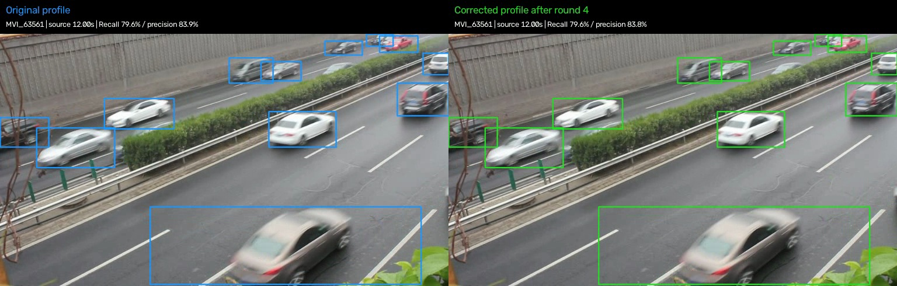
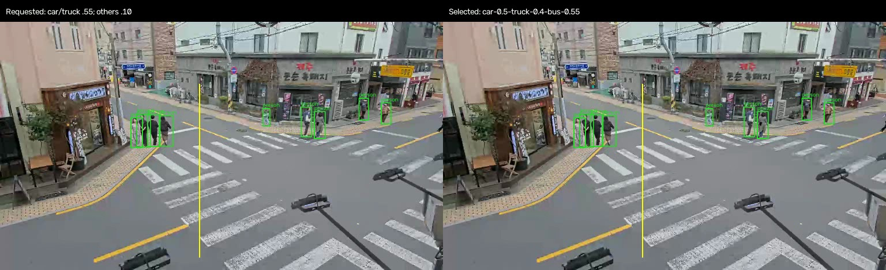
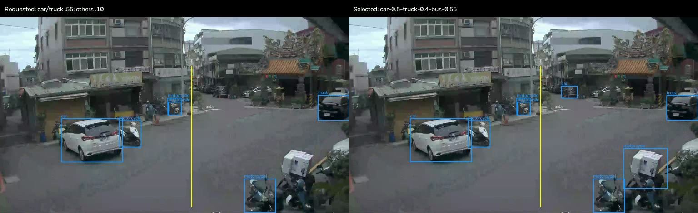

# Confidence and tracking study: saved decision

The adopted version is the **initial class-specific profile**, as recorded in `user_decision` in the recovery report. The historical `selected` and `selected_profile` fields describe the rejected development winner and have deliberately not been rewritten. General application defaults were never promoted to that experiment. No detector weights were trained or changed.

## Why the tracker adjustment was rejected

**Bold values indicate the better measured outcome for each metric; ties are left unbolded.**

The fourth-round candidate lowered person track initiation from 0.55 to 0.50 and replaced 30-frame retention with 2.4 seconds. On 440 later-window native-FPS frames with 4,179 publisher-labeled appearances, it gained three matches at the cost of 31 additional unmatched predictions. Recall increased by 0.07 percentage points; F1 declined by 0.27 and precision by 0.70. The user chose to retain the initial profile. This reverses the proposed tracker adjustment, not the useful class-specific detector cutoffs.

| Tracked-box metric | Adopted initial profile | Rejected fourth-round candidate |
| --- | ---: | ---: |
| Recall | 75.21% | **75.28%** |
| F1 | **79.97%** | 79.71% |
| Precision | **85.38%** | 84.68% |
| Matched boxes | 3,143 | **3,146** |
| Unmatched predictions | **538** | 569 |
| Missed labeled boxes | 1,036 | **1,033** |
| HOTA (0–100) | **57.00** | 56.90 |
| IDF1 (0–100) | **69.16** | 68.94 |
| ID switches | **24** | 28 |

These are tracked person/vehicle box scores using pinned official TrackEval and published ignore rules, not doorway-crossing scores. UA-DETRAC vehicle categories are grouped. The full four-round study spans 1,760 distinct source frames and 27,263 repeated per-frame labeled appearances across MOT17-02/04/09 and UA-DETRAC MVI_20011/40152/63561, at 25/30 FPS. Later windows share cameras and actors with earlier footage; this is historical-data regression evidence, not independent new-location validation. The prior person-start 0.25 candidate was also rejected after restoring 16 roof and 29 fixture false-person boxes.

## Adopted settings

Class cutoffs: car 0.50, truck 0.40, bus 0.55, person/motorcycle 0.10; bicycle remains base 0.10. Keep base detector confidence at 0.10. Person tracker high/new thresholds: 0.25/0.55; vehicle high/new: 0.20/0.20. ByteTrack: 30-frame retention, match threshold 0.9, score fusion false. No seconds-based buffer override. Duplicate filtering, camera counting geometry and existing Metal/performance work remain intact.

Usable camera files: [Seoul](../../../configs/class-confidence-seoul-songridan-gil.json) and [Taiwan](../../../configs/class-confidence-taiwan-linkou.json). The two larger-confidence experiment JSONs are historical helper profiles, not camera-line files for `--config`.

## Actual model-output comparisons

Images are frames extracted from the saved comparison MP4s without changing their embedded labels. The latest videos call the right panel “Corrected profile after round 4”; that label describes the historical candidate, which was subsequently rejected. **Left is adopted; right is rejected** in the two labeled-dataset comparisons. Header precision/recall describe the individual sequence window, not the aggregate table above.

### MOT17-09 later window

### UA-DETRAC MVI_63561 later window

### Earlier Seoul class-cutoff comparison

Left: requested car/truck 0.55 cutoff. Right: retained car 0.50 / truck 0.40 / bus 0.55 cutoffs. This earlier class-cutoff comparison is distinct from the rejected tracker adjustment.

### Earlier Taiwan class-cutoff comparison

The earlier class search uses only 34 approximate agent-reviewed foreground appearances in four frames; its scores are not comparable to the larger publisher-labeled evaluation. Both checked scooters were retained and the reported fixture/cargo false labels were suppressed in that earlier check. Motorcycle recall is not otherwise established by the larger study.

## Preserved reports and provenance

- [Earlier class-cutoff search: all candidates and references](class-confidence/report.json)
- [First three larger-sample rounds and rejected early result](larger-confidence/report.json)
- [Fourth round, later-window results, and saved user decision](larger-confidence-recovery/report.json)
- [Export hashes, output-video hashes, and screenshot frame indices](export-manifest.json)

All three reports are byte-identical copies of the local originals. Their cross-report hashes, numerical results and historical selections remain intact. Absolute local source paths inside the originals are provenance, not downloadable links. Comparison videos and original review HTML remain under the matching local `outputs/` directories; large MP4s, source datasets, model weights and caches are not published. This Markdown review and screenshots provide repository-accessible evidence without broken local-video embeds. Source datasets: [MOT17](https://motchallenge.net/data/MOT17/) and [UA-DETRAC](https://sites.google.com/view/daweidu/projects/ua-detrac); the existing camera gallery documents the Seoul/Taiwan source publishers.
